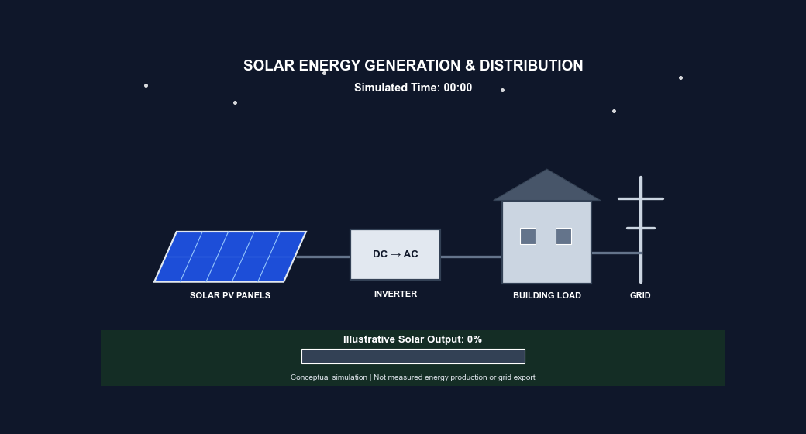
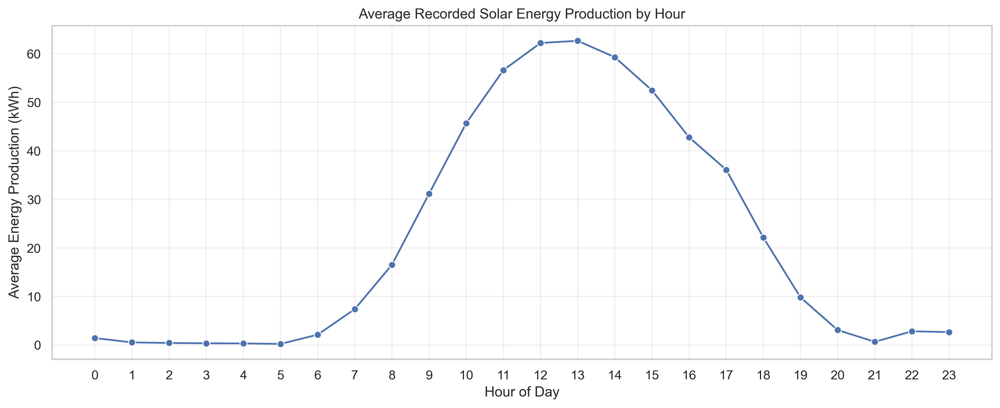
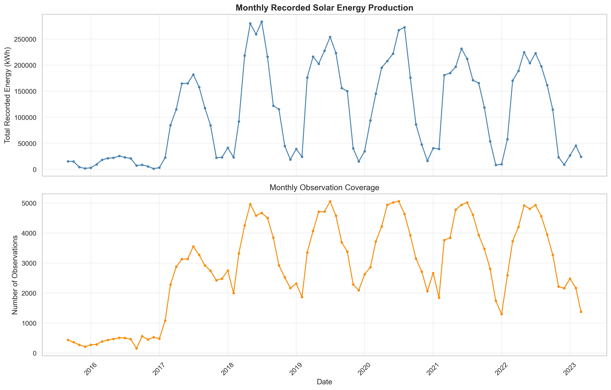
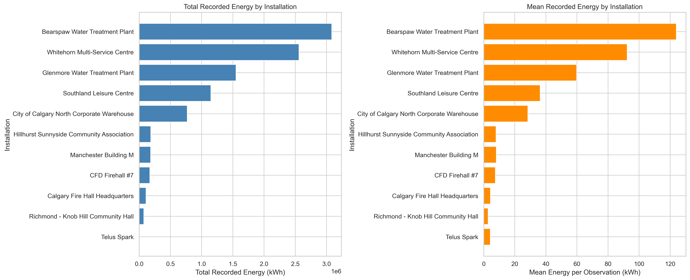

# Solar Energy Production Analysis

## Project Overview

This project focuses on exploratory data analysis (EDA), preprocessing, and visualization of photovoltaic (PV) electricity production data from installations operated by the City of Calgary, Canada.

The analysis is conducted using Python and Jupyter Notebook as part of the Big Data and Energy Data Analysis laboratory assignment.

## Project Visualizations

This project uses exploratory data analysis and visualization to investigate solar energy production patterns across photovoltaic installations.

### 1. Solar Energy Generation and Distribution

The following animation illustrates the conceptual flow of solar energy through a photovoltaic system, from sunlight capture and DC-to-AC conversion to electricity delivery.

*Note: This animation is a conceptual simulation and does not represent measured electricity distribution or grid exports.*

### 2. Hourly Solar Energy Production

The hourly production profile illustrates how average recorded solar energy generation changes throughout the day, with higher production generally observed around midday.

### 3. Seasonal Solar Energy Production

The monthly production visualization highlights recurring seasonal patterns and differences in observation coverage across the historical dataset.

*Monthly recorded totals should be interpreted alongside observation coverage because missing or irregular reporting can influence the apparent production trends.*

### 4. Solar Energy Production by Installation

The installation-level comparison highlights differences in total and average recorded energy production across the photovoltaic installations.

Bearspaw Water Treatment Plant, Whitehorn Multi-Service Centre, and Glenmore Water Treatment Plant are among the installations with the highest recorded production.

Differences in recorded production should not automatically be interpreted as differences in system efficiency because installation capacity, operating conditions, and data coverage may vary.

## Objectives

- Explore the structure and characteristics of the dataset.
- Assess data quality and perform preprocessing.
- Analyze hourly, daily, and monthly solar energy production patterns.
- Compare electricity generation across PV installations.
- Visualize and interpret key production trends.
- Discuss applications in renewable energy forecasting and performance assessment.

## Tools and Technologies

- Python
- Jupyter Notebook
- Pandas
- NumPy
- Matplotlib
- Seaborn
- Git and GitHub

## Dataset

Solar Energy Production — City of Calgary, Canada.

Source: https://www.kaggle.com/datasets/ivnlee/solar-energy-production

## Project Status

## Project Status

**Status: Completed**

The Solar Energy Production Analysis project has been successfully completed, including:

- **Exploratory Data Analysis (EDA):** Data inspection, cleaning, preprocessing, statistical analysis, and visualization of historical solar energy production.
- **Temporal Analysis:** Investigation of hourly, monthly, and seasonal production patterns.
- **Installation-Level Analysis:** Comparison of recorded solar energy production across photovoltaic installations.
- **Predictive Modeling:** Development and evaluation of a Random Forest regression model against a historical-average baseline.
- **2024 Solar Energy Forecasting:** Generation of model-based production estimates for ten installations using historical data from 2018–2022.
- **Interactive Visualization:** Development of a conceptual solar energy generation and distribution animation.

**Model Performance:**
- Random Forest MAE: **16.166 kWh**
- Random Forest RMSE: **35.375 kWh**
- MAE improvement over baseline: **32.7%**

**Note:** The 2024 forecasts are model-generated estimates, not validated actual production measurements.

The completed Jupyter Notebook, supporting visualizations, and project documentation are maintained in this repository.